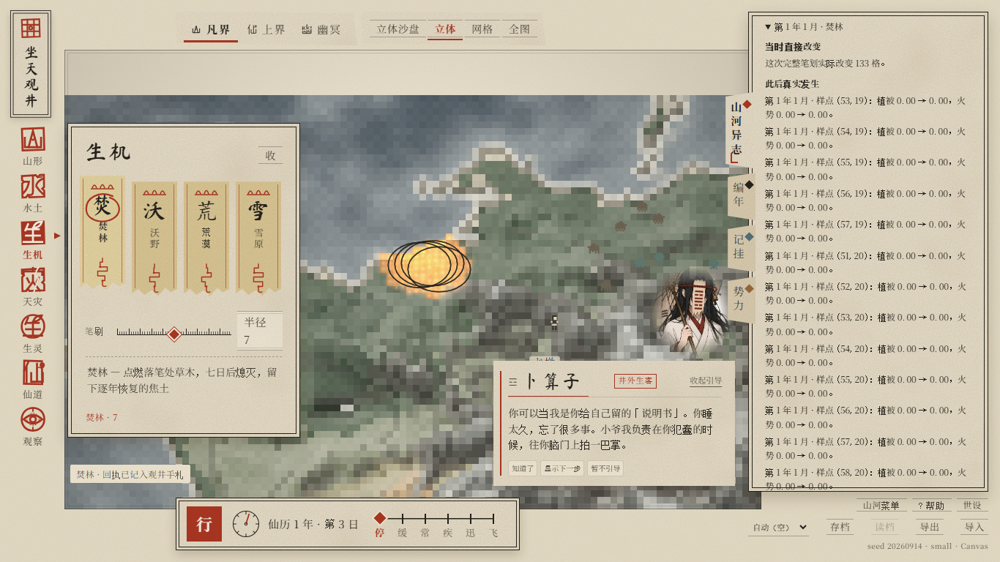
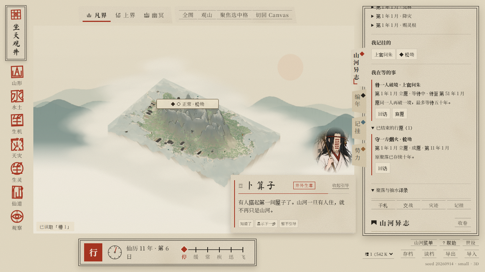

# E2-Lite · 观井有痕

基线 `main@bfc4579e2dbde7cbc364b00f15a99ceef2947c46`，独立分支 `feature/e2-lite-guan-jing-you-hen`。本阶段交付 Draft PR，不合并 main 或其他候选。

## 玩家闭环

右栏「手札」可查看焚林、降灾、赐灵根与原抽水回声。点击笔录展开「当时直接改变 / 此后真实发生 / 无法确定的关联」，从中回访真实人物、聚落或原落点。人物与地方记挂复用既有系统。

在原聚落卡立愿「守一方烟火」，正式推进十年后核对原身份是否存续；在真实修士卡立愿「待一人破境」，最多等待五十年。行愿最多同时两桩，可弃愿，保留最近十二桩结果；立愿不产生奖励、事件或额外随机抽取，不改变 NPC 的命运。保存、读档及导入之后仍可回访。

## 实现边界

- `sim/journal.js` 只保存有界观察元数据：新增笔录最近32笔、局部环境样点最多16处、赐根明细最多24人；超出窗口有明确提示。
- `History.end()` 是 Canvas/Three 共享的唯一成功提交点；预览、取消、异常与无实际变化不记成功笔录。抽水仍在 `world.observeEcho`，不复制进新块。
- `advanceWorld` 只在原推进片段完成后检查两桩行愿，不增改模拟分片、随机流或世界事件。人物按位面和本世 ID、正式跨界链读取，转世不续认；资料缺失明确失考。
- v11 只新增可缺省的 `journal.v=1` 块；旧档无块正常恢复。新块先校验再恢复候选世界，实体行列、G8 运行期检查点与自动/手动保存协议保持原样。
- UI 继续使用原右栏，关闭手札时不读取或刷新新笔录列表。卡片控件保护世界/对象身份及焦点，不在地图新增常驻手札标记。

## 定点验收

本地 `test:e2-lite` 通过19项模型/存档检查和6组生产手势接线检查；`npm test`、`test:e0`、`test:g7`、`test:regression`、`test:view`、`test:qol`、`test:g8` 均退出0。`build` / `test:package` 均退出0：551文件、17 GLB、169个脚本目标，包含新模块和显式脚本。保存等价、三界长回归和完整 Fast/Heavy 以本 Draft PR 对应 HEAD 的 GitHub CI 为准，不能用旧主干成功替代。

真实 Edge 使用正式创世菜单生成 small 200×128、seed 20260914；Canvas 1366×768 和 Three 1280×720 均完成实际神力输入、手札、两类行愿、正式十年推进、结局读取、命名槽存读档、自动保存、坏新块拒载、归档行愿原址回访和换世界。两种模式控制台错误均为0。Browser 插件缺席，复用仓库 CDP；Windows 沙箱限制下使用获准的隔离进程，自有会话退出并清理。

游戏时间通过原 `Sandbox.advanceDays` 加速，不是等待十年的墙钟测试；未修改人口或强行指定幸存/突破。Three 先投影实际渲染实例，再由正式射线确认真实对象，避开地形、建筑与聚落标签遮挡后执行鼠标输入。软件光栅功能通过不代表 GPU 性能通过。没有运行800年 Nightly 或新的 GPU 性能实验。

## 最小画面证据

## 保留限制与回退

只覆盖本轮三种新增神力回执，抽水复用 E0；没有通用任务引擎、全世界历史库、自动快进、卷末或 G9 内容。历史窗口会淘汰，缺可靠跨界链时失考；不据环境样点推断全区因果。旧档未保存的 RNG 游标与原地形量化边界继续保留。

候选如需回退，在独立分支正常 revert 本次功能提交即可；不重置或强推 main，不删除其他分支与证据。
